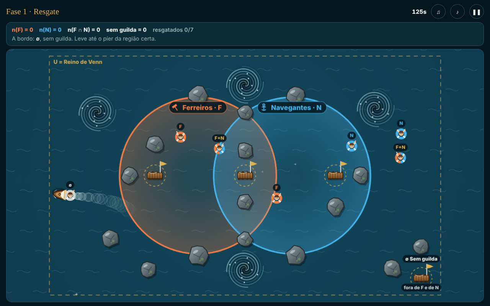
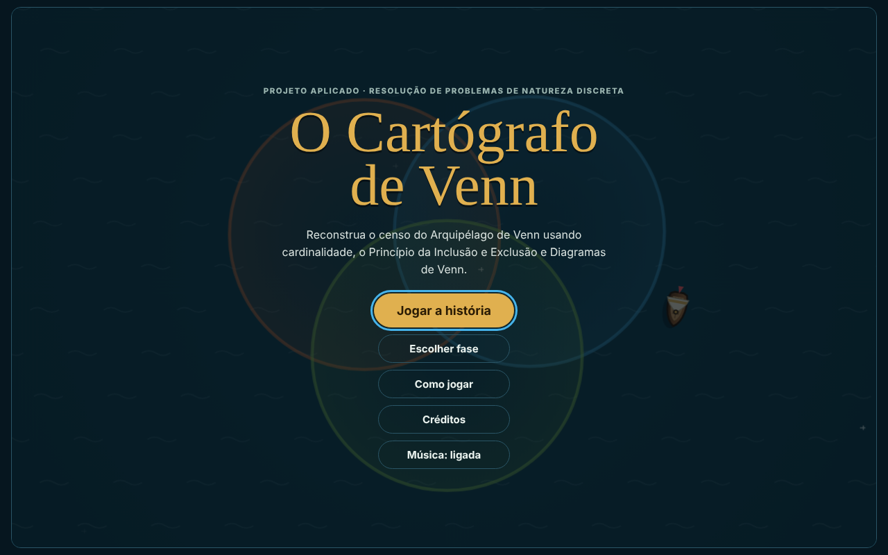
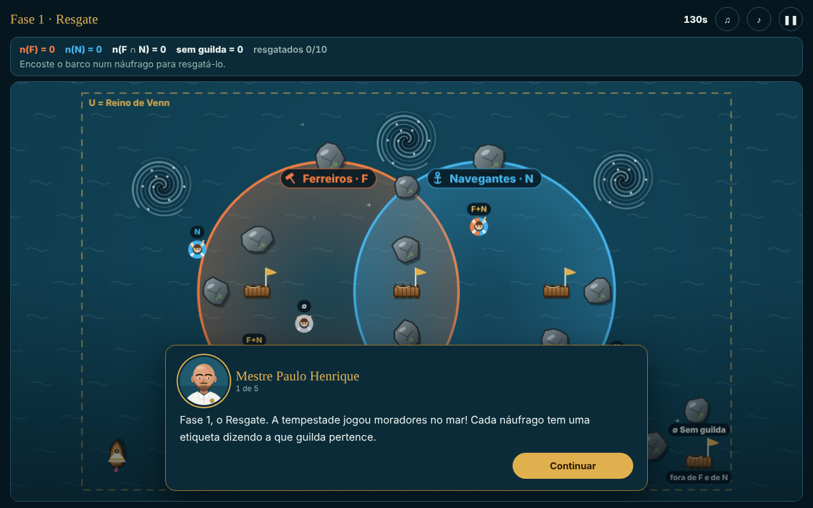
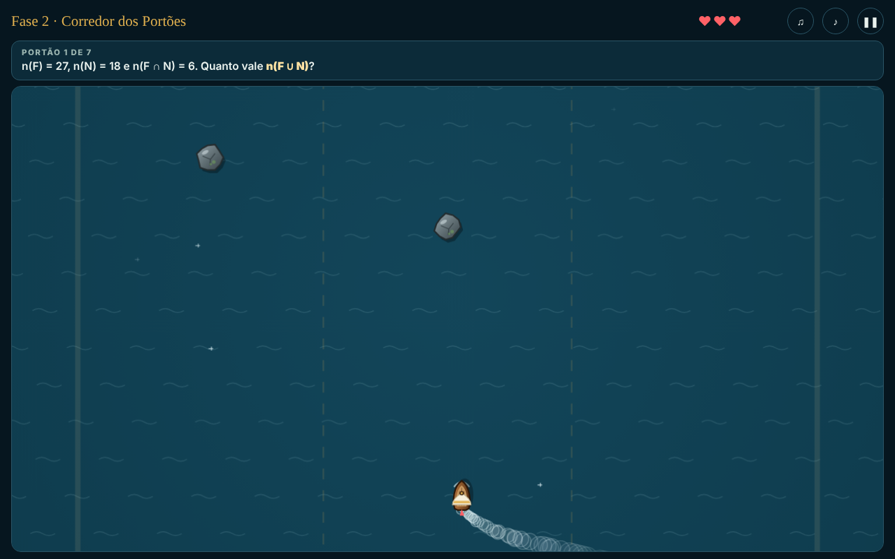
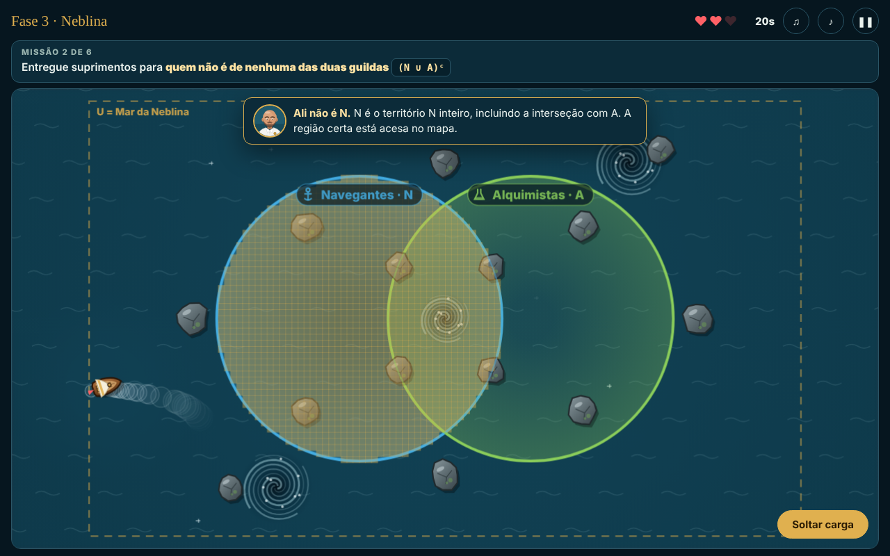
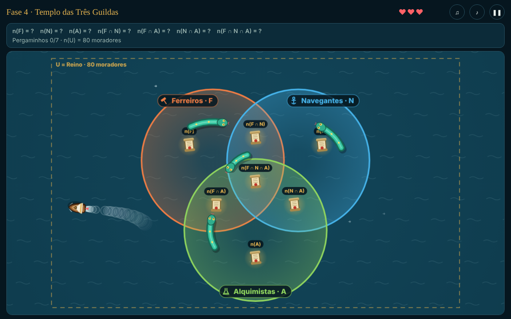
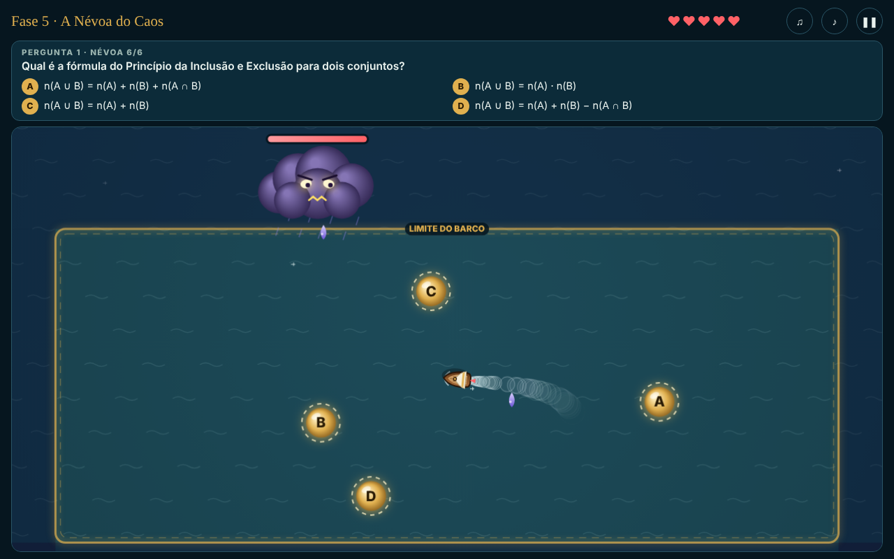

# O Cartógrafo de Venn

**[🇧🇷 Português](#-português)** | **[🇺🇸 English](#-english)**



**▶ Jogar / Play:** https://caioportela17.github.io/o-cartagrafo-de-venn/

---

## 🇧🇷 Português

Jogo educativo para alunos do ensino médio sobre **cardinalidade, Princípio da Inclusão e Exclusão e Diagrama de Venn**. O jogador pilota um barco por um mapa em que cada território é um conjunto: estar onde dois territórios se cruzam é estar na interseção.

Projeto Aplicado da disciplina **T162 — Resolução de Problemas de Natureza Discreta**, Ciência da Computação, UNIFOR. Professor Paulo Henrique.

### O enredo

A Névoa do Caos apagou o Grande Censo do Arquipélago de Venn, onde vivem três guildas: **Ferreiros**, **Navegantes** e **Alquimistas**. O jogador é o aprendiz do **Mestre Paulo Henrique**, o mapeador real, e precisa recontar todos os moradores sem repetir ninguém até derrotar a Névoa.

### As fases

| Fase | Como se joga | Conteúdo |
|---|---|---|
| 1. Resgate | Leva náufragos ao píer da região certa, desviando de rochas e redemoinhos | Cardinalidade e regiões do Venn |
| 2. Corredor dos Portões | Passa pelo portão com a resposta certa enquanto a correnteza acelera | n(F ∪ N) com 2 conjuntos |
| 3. Neblina | Encontra no escuro a região pedida e solta a carga | Complemento e notação de conjuntos |
| 4. Templo das Três Guildas | Coleta 7 pergaminhos fugindo de serpentes marinhas | Inclusão-exclusão com 3 conjuntos |
| 5. A Névoa do Caos | Pega a esfera da resposta certa desviando de raios | Quiz com banco de 16 questões |

As fórmulas usadas no jogo:

```
n(A ∪ B)     = n(A) + n(B) − n(A ∩ B)
n(A ∪ B ∪ C) = n(A) + n(B) + n(C) − n(A ∩ B) − n(A ∩ C) − n(B ∩ C) + n(A ∩ B ∩ C)
```

### Recursos

- Tutorial do Mestre Paulo Henrique antes de cada fase, tela "Como jogar" e "Rever instruções" na pausa
- Explicação com a conta certa a cada erro, e a região correta acende no mapa
- Feedback visual e sonoro em cada acerto e erro
- Três músicas geradas pelo próprio código (menu, fases e chefão)
- 3 estrelas por fase, salvas no navegador
- Funciona no PC e no celular, em modo paisagem ou retrato

### Controles

| Ação | Teclado | Celular |
|---|---|---|
| Mover o barco | Setas ou W A S D | Tocar e segurar onde o barco deve ir |
| Soltar carga (fase 3) | Espaço | Botão "Soltar carga" |
| Responder perguntas | Teclas 1 a 4 | Tocar na alternativa |
| Pausar | P ou Esc | Botão ❚❚ |

### Como rodar

Não precisa instalar nada. Abra o `index.html` em qualquer navegador, ou acesse o link do GitHub Pages acima.

### Tecnologias

HTML5 Canvas, JavaScript puro e Web Audio API, tudo em um único arquivo, sem bibliotecas.

### Como o código funciona

| Parte | O que faz |
|---|---|
| `steer()` | Física do barco: aceleração, atrito e limite de velocidade |
| `dist() < r` | Teste de região: o barco está dentro de um conjunto quando a distância ao centro do círculo é menor que o raio |
| `Phase1` a `Phase5` | Uma função por fase, todas com `init`, `update`, `draw` e `hud` |
| `genQ2()` / `mkQ()` | Geram contas e alternativas, calculando o gabarito pela própria fórmula |
| `BANK` | Banco de 16 questões do chefão |
| `SONGS` | As três músicas (baixo, acordes e melodia) |
| `frame()` | Laço principal, cerca de 60 quadros por segundo |

### Screenshots

| | |
|---|---|
|  |  |
|  |  |
|  |  |


---

## 🇺🇸 English

An educational game for high school students about **cardinality, the Inclusion–Exclusion Principle and Venn diagrams**. The player sails a boat across a map where each territory is a set: being where two territories overlap means being in their intersection.

Applied Project for the course **T162 — Discrete Problem Solving**, Computer Science, UNIFOR (Brazil). Professor Paulo Henrique.

### Story

The Chaos Mist erased the Great Census of the Venn Archipelago, home to three guilds: **Blacksmiths**, **Navigators** and **Alchemists**. The player is the apprentice of **Master Paulo Henrique**, the royal mapmaker, and must count every resident without counting anyone twice, then defeat the Mist.

### Levels

| Level | Gameplay | Math topic |
|---|---|---|
| 1. Rescue | Bring castaways to the dock of the right region, avoiding rocks and whirlpools | Cardinality and Venn regions |
| 2. Gate Corridor | Sail through the gate with the right answer as the current speeds up | n(A ∪ B) with 2 sets |
| 3. Fog | Find the requested region in the dark and drop the cargo | Complement and set notation |
| 4. Temple of the Three Guilds | Collect 7 scrolls while escaping sea serpents | Inclusion–exclusion with 3 sets |
| 5. The Chaos Mist | Grab the orb with the right answer while dodging lightning | Quiz with a 16-question bank |

### Features

- Tutorial by Master Paulo Henrique before each level, a "How to play" screen and instructions available from the pause menu
- Every mistake shows the correct calculation and lights up the right region on the map
- Visual and sound feedback on every right and wrong answer
- Three songs generated by code (menu, levels and boss)
- Up to 3 stars per level, saved in the browser
- Works on desktop and mobile, in landscape or portrait

### How to run

No installation needed. Open `index.html` in any browser, or use the GitHub Pages link above.

### Tech

HTML5 Canvas, vanilla JavaScript and the Web Audio API, all in a single file with no libraries.
